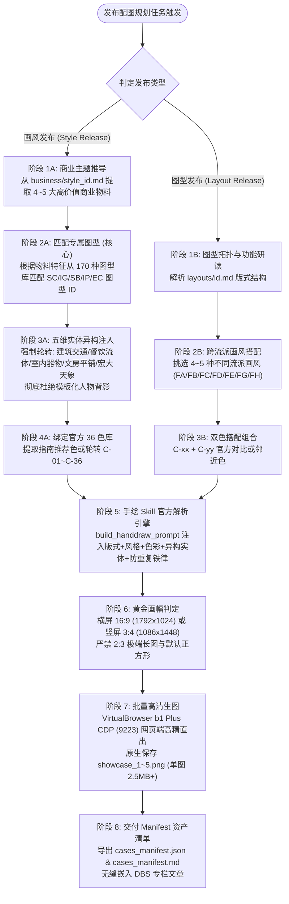

# 风格与图型发布配图规划器 (Release Illustration Planner)

专为 HandRaw 风格库发布新【画风 (Style)】或新【图型 (Layout)】文章时定制的**专业配图规划与生图工作流**。

---

## 一、核心定位与四大设计哲学

在撰写风格发布或图型发布的专栏文章时，插图并非泛泛的装饰图，而是**“向读者证明手绘 Skill 在真实商业物料中落地能力”的硬核实测案例（Showcases）**。

本 Skill 确立了四大核心设计原则：

1. **主题与媒介咬合（Theme-to-Medium Coupling）**：
   - 严禁空泛无物的“纯风景”或“无意义摆件”；
   - 必须基于新风格的艺术特征（或从 Stage 2 生成的 `business/{style_id}.md` 商业应用指南中）推导出 4~5 个真实、高频、具体的商业应用主题（如城市限定明信片、外带杯套展开面、独立唱片封套、文具手账贴纸、移动 APP 开屏等）。
2. **【核心铁律】主题出来后，必须搭配图型（Domain-to-Layout Pairing）**：
   - **画风发布模式**：当 4~5 个商业主题确定后，**绝不能只出无版式的散图，必须从 HandRaw 170 种排版图型库中为每个商业主题严密挑选最契合的图型 ID**（例如文旅配 `SC-021` 左右对开视口，杯套配 `SC-004` 图文分区卡，音乐配 `SB-001` 电影宽银幕分镜，文具配 `IG-007` 标签矩阵卡，APP 运营配 `SC-008` 居中大卡片）；
   - **图型发布模式**：当功能主题确定后，必须为每个场景挑选分属不同艺术流派的画风 ID（如清晰线描、水彩绘本、复古波普、日系清透、新国潮工笔、动漫光影等），全面检验该图型的跨风格泛化能力。
3. **【防同质化铁律】五维实体异构与画面零雷同（Visual Diversity & Anti-Repetition）**：
   - **严禁 AI 意向同质化坍缩**：坚决杜绝“每张图都是单一女性/女孩后背或侧面仰望天空”的模板化通病！
   - **五维实体强制轮转**：任何一组 5 张实测案例，其画面核心实体必须**强制横跨 5 种截然不同的物理形态**：
     - `① 建筑与交通实景 (Architecture & Transit)`：如复古双节有轨电车、老火车站台、沿海铁桥、红砖街巷；
     - `② 餐饮流体与微距静物 (Food, Beverage & Liquid Still Life)`：如木质吧台上的柑橘冰萃咖啡玻璃杯、冰块透光折射焦散 (Caustics)、凝结水珠；
     - `③ 室内器物与声学空间 (Interior & Acoustic Objects)`：如旋转的木壳黑胶唱机、百叶窗斜射暖光光斑、监听耳机、吉他架；
     - `④ 文房平铺与手账工艺 (Stationery Flatlay Knolling)`：自上而下的俯视平铺陈列，棉麻手账本、黄铜钢笔、火漆印信笺、红结绳；
     - `⑤ 宏大天象与奇幻地景 (Celestial Landscape & Worldview)`：宏大深蓝天穹、分岔彗星粒子尾、镜面陨石湖、群山与星轨。
   - 提示词中强制注入正面实体约束与反面排他指令，彻底杜绝元素重复。
4. **官方手绘 Skill 解析引擎闭环（Handdraw Prompter Integration）**：
   - 严禁私自手写拼接提示词；
   - 必须通过 `handdraw-style-prompter` 的底层解析器，将【图型排版规则】+【画风特征与模型能力】+【36 官方配色】+【画幅规格】+【图文一体升华指令】+【去口号化负向约束】编译为官方标准提示词；
   - 严格绑定 VirtualBrowser `b1` Plus (ChatGPT Plus 专享账号，端口 9223) 执行原生出图，输出 `cases_manifest.json` 与 `cases_manifest.md`。

---

## 二、双轨工作流规范



---

## 三、五维实体异构与零雷同详细规范

| 维度序号 | 实体异构类别 | 视觉代表元素 | 推荐景别与视角 | 画面人物铁律 | 典型商业物料 |
| :---: | :--- | :--- | :--- | :--- | :--- |
| **01** | **建筑与交通实景**<br/>(Architecture & Transit) | 复古双节有轨电车、老火车站台、沿海铁桥、坡道街巷、交错电线杆 | 开阔长焦压缩景深、街景全景 | **纯实景建筑与车辆，绝无单一人像特写，绝无女孩背影** | 城市限定明信片、在地文旅打卡折页、文创胶片 |
| **02** | **餐饮流体与微距静物**<br/>(Food & Beverage Still Life) | 晶莹高脚玻璃杯、柑橘冰萃咖啡、透明冰块、柠檬切片、焦散光斑 (Caustics)、水珠 | 微距特写、45度台面俯角 | **纯饮品与器皿静物，画面无人物，绝无女孩背影** | 外带杯套展开面、限定杯身、门店窗贴、包装贴纸 |
| **03** | **室内器物与声学空间**<br/>(Interior & Acoustic Gear) | 木壳复古黑胶唱机、旋转黑胶盘、唱针、百叶窗横切光斑、木吉他、监听耳机 | 电影宽银幕室内中景、逆光光束 | **纯室内器材与光影写生，绝无女孩背影** | 专辑封面、黑胶唱片封套、演出海报、实体票根 |
| **04** | **文房平铺与手账工艺**<br/>(Stationery Flatlay Knolling) | 展开的棉麻手账、黄铜旋转钢笔、半透明硫酸纸信封、火漆印章信笺、红色结绳 | 垂直 90 度自上而下俯视平铺 (Flatlay) | **纯纸本与工艺工具陈列，图鉴手账感，绝无女孩背影** | 手账胶带、便签本、信纸信封套装、纪念书签 |
| **05** | **宏大天象与奇幻地景**<br/>(Celestial Landscape) | 黄昏深蓝天穹、分岔双子彗星、粒子光尾、远古陨石环形湖、镜面星轨倒影、群鸟 | 超广角宏大远景、天象全景 | **纯壮阔大自然与天文空镜，宏大史诗感，绝无模板化单人站立仰望** | 游戏移动 APP 开屏、版本活动主视觉 KV、成就卡 |

---

## 四、色彩与画幅红线铁律

### 1. 官方 36 色库铁律（Zero Color Hallucination）
- 所有配色必须 100% 映射自手绘 Skill 官方标准配色库 [`references/colors.json`](../handdraw-style-prompter/references/colors.json)（编号 `C-01` ~ `C-36`，路径相对安装包根目录解析）；
- 严禁凭空捏造色彩编号；
- 单色案例采用 `C-xx`；双色混搭采用 `C-xx + C-yy`。

### 2. 画幅尺寸规范（Anti-Truncation Sizing）
- **横屏超宽画幅**：强制指定 `1792x1024`（16:9 比例），适用于宽银幕分镜、全景地图、双重视口、长条杯套展开面；
- **竖屏黄金画幅**：强制指定 `1086x1448`（3:4 黄金比例），适用于社媒卡片、手机开屏、垂直信息图；
- **【绝对红线】绝对严禁使用 2:3 (`1024x1536`) 作为配图！** 在 X (Twitter) Articles 与自媒体信息流中，2:3 极端长图会被强制上下截断，导致大标题与结论丢失。

---

## 五、手绘 Skill 原生提示词组装标准

每一个规划案例的提示词，必须通过底层解析脚本完整包含以下结构：

```text
图型：{图型官方中文名称}。
主题色：{官方色号与中文名}（{英文名}）。
主题：{具体的商业物料与展现情节}。
画幅规格：{1792x1024 或 1086x1448 画幅防截断约束}。
图型排版规范：{layouts/<id>.md 中的视口与排版约束}
风格名称：{generation_name}。参考作者/风格名称：{reference}。
核心风格特征：{从 model_capabilities.json 与 styles.json 提取的纯艺术笔触}。
【画面核心实体与场景（严格聚焦，绝不雷同重复）】：{五维异构实体的具体物理细节与光影描述}。
【镜头景别与构图】：{景别视角约束}。
【画面主体严格防模板化铁律】：严禁画面出现千篇一律的女性/女孩后背或侧面！严禁模板化单人站立仰望天空！必须专注刻画指定的【{实体类别}】！5个案例的主体元素彻底异构、跨度极大、不得雷同！
【如果主题直白包含画面元素那就按主题出图，文案由你来升华，但是不要直接描述画面。 如果主题比较概念化，那么文案和主题尽量保持一致，如果文案较长由你提炼，由你先设计画面隐喻（人类和非人类都行）再出图。 文字参与构图，图文一体】
画面文案铁律：严禁在图内标题、标签、印章或说明文案中出现“新中式”、“东方”、“国潮”、“慢生活”等风格口号空话。画面风格由画风自然呈现，文案必须100%基于真实具体的业务内容或生活自愈细节。
```

---

## 六、CLI 快速执行指令

通过内置 Python 脚本快速发起规划与生图：

### 1. 为新画风规划配图并强制重新批量生图
```powershell
python skills/release-illustration-planner/scripts/planner.py `
  --style FG-024 `
  --article-title "手绘skill新增风格：新海诚《你的名字。》" `
  --force
```

### 2. 预演模式（仅输出方案与提示词，不消耗算力）
```powershell
python skills/release-illustration-planner/scripts/planner.py `
  --style FG-024 `
  --dry-run
```
